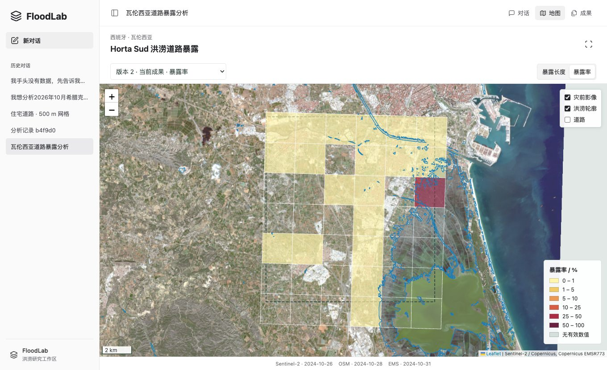
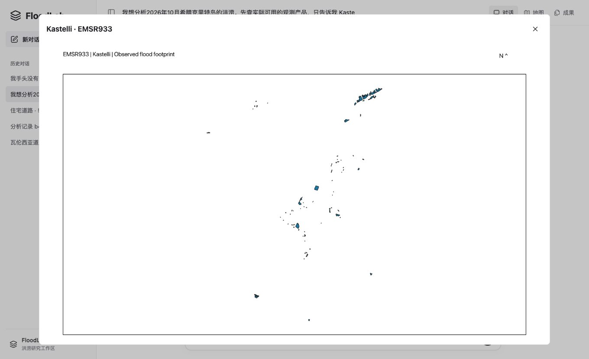

# FloodLab

FloodLab 是一个可以用中文对话的洪涝遥感工作台。你可以从“最近哪里发生了洪涝？”开始，选定事件后再追问“那片区域有多大，哪里最集中？”。Pi 查找资料、确认研究区和观测时间；QGIS 从实际下载的空间数据计算结果，并导出可编辑地图。

**[下载桌面版 0.6.0](https://github.com/hhman3097/FloodLab/releases/tag/v0.6.0) · [课程报告 PDF](report/build/main.pdf) · [LaTeX 源码](report/main.tex) · [实验复现](docs/REPRODUCTION.md)**

## 先试一下

1. 在 Releases 下载对应平台的 ZIP，解压后打开 FloodLab。Mac 包适用于 Apple 芯片；Windows 包为 x64，已构建、尚未实机验收。包中包含 Pi 和 QGIS，首次启动会在本机展开运行环境。
2. **不用 Key 也可以看案例。** 点击首页的「查看案例」，切到「地图」或「成果」，可查看两种网格尺度下的道路暴露及排名。
3. **要运行新分析**，在输入框下方点击「配置模型」，填写支持 Responses API 的服务地址（到 `/v1`）、模型名和自己的 Key。新建对话时可以选择工作区，后续的原始数据、来源记录、统计结果和地图都写在这次对话的独立子目录中。

## 演示一：让 Agent 自己找数据

下面是克里特岛验收任务的简化问法。这个案例的观测图层未预装，重跑需要联网。

> **你：** 我想分析 2026 年 10 月希腊克里特岛的洪涝。先查 Kastelli 有哪天的观测，不要计算。  
> **你继续问：** 那就分析这个区吧。覆盖了多大面积？哪几个 1 公里网格最集中？给我一张地图。

第一轮，Pi 查询 Copernicus EMS 事件及产品目录，确认了研究区和观测时间。第二轮，它沿用同一工作区，下载 EMSR933 产品 2962，再调用 QGIS。实际运行中，**2026 年 10 月 6 日的 88 个观测多边形合并后为 0.2413 km²**，涉及 20 个网格。这里统计的是该产品标注的积水及洪水痕迹，并非整座岛的受灾总面积。

[查看专题图 PDF](report/figures/kastelli-observed.pdf) · [核对数值、来源和工具调用顺序](desktop/qa/project-check.json)

## 演示二：同一场洪涝，换一个问题

在瓦伦西亚案例里，先看所有道路，再问：“只看主干道路，网格换成 2 公里，按暴露率排名。”还可以追问：“住宅道路呢？改成 500 米网格。”两次追问都改变了统计对象，不能直接沿用旧地图。

| 已运行的任务 | 网格数 | 可以对比什么 |
|---|---:|---|
| 全部道路，1 km | 156 | 各格有多少米道路与洪涝轮廓重叠 |
| 四类主干道路，2 km | 42 | 哪些格的重叠路段占该格道路的比例最高 |
| 住宅道路，500 m | 624 | 更细尺度下住宅道路暴露的空间差异 |

三组网格均有独立程序逐格复算。无道路的格子，暴露率记作空值而非零。这里的“暴露”只表示道路与洪涝轮廓在平面上重叠，不能据此判定道路已封闭。[查看原始分析与核验记录](event/runs/gis-agent-pilot-v2) · [住宅道路结果](event/runs/workbench_d0e0a1f802)

## 还可以做什么

| 你的需求 | FloodLab 的处理方式 |
|---|---|
| 没有地点和数据，想查近期灾情 | 检索事件目录、新闻索引和中文原文，区分发布日期、发生日期、预警与灾后重建；证据不足时说明缺什么。[检索实测](desktop/qa/search-051.json) |
| 找到事件，想知道能不能画图 | 查询具体研究区、观测日期及可下载产品；只有取得匹配的多边形才计算面积。EMS 并不覆盖所有洪水。 |
| 想继续编辑或复核 | 可打开 PDF、QGIS 工程和空间数据；保留输入来源、文件散列及各轮成果。 |
| 想知道 Agent 为什么这样做 | 展开工具记录，核对查询、下载与计算；[对照实验](event/runs/gis-comparison)与[课程报告](report/build/main.pdf)区分工程验收和精度评估。 |

## 小组协作入口

### Pi 怎么适配洪涝研究

| 用户说什么 | 对应的方法 |
|---|---|
| “最近国内哪里发洪水了？” | [事件检索](event/skills/flood-discovery/SKILL.md)：区分预警、重建报道和新发事件，用原文核对地点与时间。 |
| “那分析一下，影响大吗？” | [选择分析口径](event/skills/question-to-measure/SKILL.md)：先确定用户关心的是事件经过、面积还是道路重叠；只推荐数据能支持的问题。 |
| “就查这个地方，帮我算。” | [事件工作区](event/skills/event-workspace/SKILL.md)：匹配观测产品，下载到当前对话目录，再调用 QGIS。 |
| “7.2% 是指整个地区吗？” | [结果解释与核验](event/skills/result-interpretation/SKILL.md)：说明分母、单位和观测范围，区分内部一致性检查、独立复算与地面真值。 |

这些 Skill 是运行时提供给 Pi 的领域指导；下载、坐标转换和几何计算由工具执行。增加指导本身不等于准确率已经提高。

| 内容 | 位置 |
|---|---|
| 桌面应用、Pi 与本地工作台 | [desktop](desktop) · [workbench](workbench) |
| 检索、空间分析与领域 Skill | [event](event) · [skills](event/skills) |
| 遥感实验输入、指标与地图 | [事件输入](event/inputs) · [测试结果](outputs/test) · [研究地图](event/maps) |
| 编辑报告 | [主文档](report/main.tex) · [插图](report/figures) · [字体](report/fonts) |
| 实验与成员核对 | [实验日志](EXPERIMENT_LOG.md) · [团队记录](TEAM_REVIEW.md) |

从仓库根目录运行 `latexmk -xelatex -cd -outdir=build report/main.tex` 可重新编译报告。讨论或复现某个差异时，请注明事件编号、研究区、观测时间和网格大小；不要在 Issue、截图或提交中附上 API Key。
